# Schedule Executor Display 전면 개편 보고서

- 날짜: 2026-10-12 · 브랜치: `ubuntu_gpu_mobilint_demo` · 플랫폼: CPU-NPU (`deploy_cpu_npu`)
- 지시문: `DISPLAY_REDESIGN_INSTRUCTIONS.md` (PART A 레이아웃 개편 + PART B 실행 검증)
- 판정: **PART B 30/30 run 통과, working set 변경 6/6 통과, 정합성 스팟체크 4/4 완료.**
  단, 첫 실행은 27/30이었고 3건은 테스트 판정 기준 오류였다(§9). 제품 결함은 검증 도중 5건을
  찾아 고쳤다(§9.2).

**검증 조건에 대한 주의 두 가지**

1. 테스트 시점에 데스크톱 세션이 **잠금 상태**(GNOME lock)였다. Display 창은 실제 X 디스플레이
   `:1`에 매핑되어 정상적으로 그려졌지만 루트 스크린샷에는 잠금 화면만 찍히므로, 캡처는
   `gnome-screenshot`이 아니라 **Display 창이 자기 내용을 직접 저장**(`QWidget.grab()`)한 것이다.
   모니터에 실제로 비친 모습을 사람 눈으로 본 것은 아니다. 잠금 해제 후 한 번 육안 확인을 권한다.
2. 15세트의 predicted best는 전부 llama1b를 NPU에 두었다. 그래서 지시문의 "CPU llama1b는 0건
   허용" 예외는 **한 번도 발동되지 않았다** (모든 모델이 30초 안에 1건 이상 완료).

---

## 1. 폐지한 창 · 삭제한 버튼 (시그널 정리 포함)

**"System and Model Information" 창(`InfoWindow`)을 완전히 제거했다.** `info_window.ui` 파일 삭제,
`unified_viewer.InfoWindow` 클래스 삭제, 이 창을 만들던 유일한 경로
(`schedule_executor_main.main()`의 `InfoWindow(parent=None)`와 `UnifiedViewer.__init__`의 대체 생성)
삭제. 실행 중 창은 Display 하나뿐이다.

| 요소 | 처리 | 함께 정리한 코드 |
|---|---|---|
| View1~4 Avg FPS / latency | → 각 주연 뷰의 지표 띠 (§2.3) | `update_model_performance`, `VIEW_COLORS` 삭제 |
| Total Throughput / Avg / Deadline miss / Score / q95 | → 우측 집계 패널 | `update_metrics` 삭제 |
| Current Schedule | → 우측 패널 상단 `schedule_name_label` | `update_schedule_name` 삭제 |
| CPU Usage / LoadAvg / CtxSwitches | → 우측 패널, **CPU 사용률만** | `update_cpu_info`, `update_npu_info`(가짜 NPU 수치) 삭제 |
| Start Execution | 삭제 | `on_start_button_clicked`, `Controller.start_execution`, `ScheduleExecutor._set_start_button_enabled` |
| Stop Execution | 삭제 | `on_stop_button_clicked`, `Controller.stop_execution`, `ScheduleExecutor.stop`, `Controller` 클래스 전체 |
| Use multiple schedule files / Schedule Folder / Browse | 삭제 | `on_browse_schedule_folder_clicked` (이 값을 읽는 코드는 원래 없었음) |
| Reallocation trigger [Disabled] | 삭제 | `update_trigger_below_metrics`, `_evaluate_drop_rate_trigger`, `_evaluate_queue_delay_trigger` |
| Schedule Duration 입력 | 삭제 | `get_execution_duration` |
| (연결만 있고 위젯이 없던) `best_button` | 삭제 | `load_best_schedule` |

**Start 버튼이 없어진 데 따른 동작 변화 1건.** `schedule_executor_main.py`를 `--schedule_name` 없이
`--auto_start_all`도 없이 띄우면 예전에는 Start 버튼을 기다렸다. 이제는 **프로세스 시작과 함께 바로
실행**하고, 끝나면 창을 열어 둔다(`--auto_start_all`이면 종료). 메인 창과 데이터 수집 스크립트
(`run_collection.py`, `collect_run.py`)는 모두 `--schedule_name` 경로를 쓰므로 영향 없음 — 수집 경로
(offscreen, `DISABLE_VISUALIZATION=1`)가 그대로 결과 JSON을 저장하는 것을 확인했다.

## 2. 레이아웃 구현 방식

`schedule_executor_display.ui`를 좌(`leftPanel`) / 우(`rightPanel`) 2열로 다시 짰다.

```
centralwidget (QHBoxLayout mainLayout)
├─ leftPanel   videoLayout(2×2: view1..view4) + stop_all_button
└─ rightPanel  show_all_toggle · exhibition_badge · rightStack
               ├─ measurePage     OVERALL / combination_N / Score(크게) / Throughput·Avg·Miss·q95·CPU
               └─ exhibitionPage  "Score x / y FPS" · 구분선 · supportScroll(조연 타일)
```

### 2.1 우측 고정폭, 좌측 고정 메커니즘
- **우측 열 = 창 폭의 21%** (`unified_viewer.RIGHT_COL_RATIO`, 한 곳에서 정의).
  `UnifiedViewer._apply_right_width()`가 `resizeEvent`마다 `rightPanel.setFixedWidth(round(폭×0.21))`을
  건다. 우측 열의 폭은 **창 폭만의 함수**이고 내용물·모드·모델 수는 관여하지 못한다.
- 좌측은 나머지 전부. 2×2 셀은 `sizePolicy = Ignored`, 행·열 stretch 동일 → 픽스맵 크기나
  내용이 셀 크기를 밀지 못한다. 그리드 폭이 홀수면 우측에 1px을 더 줘서 **두 열이 픽셀 단위로 동일**하다.
- 모드 전환은 `rightStack.setCurrentIndex()`와 배지 show/hide뿐이라 좌측 레이아웃에 닿지 않는다.

### 2.2 리사이즈 동작
창을 1680×1110 → 1500×1000으로 바꿔 실행: 우측 354px(21.07%) → 316px(21.07%), 주연 타일
648×509 → 577×454. 비율 유지, 좌측은 창 크기에만 반응. 최소 창 크기 1040×700.

### 2.3 주연 뷰 내부 (두 모드 공통)
헤더(모델명·디바이스 배지·FPS, 기존) → **지표 띠(신설)** → 렌더링(기존) 순서.
지표 띠는 `demo_render.insert_metric_strip()`이 헤더와 본문 **사이에 24px 행을 끼워 넣는다** —
본문을 덮지도 줄이지도 않으므로 기존 렌더링은 그대로다(타일 이미지가 640×480 → 640×504).
내용은 `lat`(평균 추론시간) │ `miss`(deadline miss %) │ `wait`(평균 큐 대기).
miss는 10% 이상 주황, 50% 이상 빨강(`demo_render.MISS_WARN/MISS_ALERT`).

값은 **새로 계산하지 않았다.** 뷰 핸들러가 이미 들고 있는 `avg_infer_time`, `late_count`,
`infer_count`, `avg_wait_ms`와 피더의 `drop_counts`/`offered_counts`를 1초 타이머
(`update_cpu_npu_usage`)가 읽는다. 뷰별 miss는 기존 전체 miss 합산식의 **뷰별 항 그대로**다
(`(late + dropped) / offered`). 전체 Score도 기존 식(`total_fps − 100 × miss`) 그대로.

### 2.4 Stop All
좌측 2×2 바로 아래, 좌측 폭 전체, 높이 64px, 빨강(#c62828). 연결된 슬롯은 기존
`on_stop_all_clicked → shutdown_views()` 그대로이며 정리 순서는 건드리지 않았다(§9.2의 hang 수정 1건 제외).

### 2.5 우측 열 — 조연 타일
조연 = 주연 4개에 들지 못한 실행 모델 전부. 타일은 캡션(모델명 · 디바이스 배지 · 수치 1개)
+ 실제 렌더링 축소본(`demo_render.support_thumb`, 헤더는 축소 시 읽을 수 없어 잘라내고 캡션으로 대체).
`_reflow_support()`가 1열로 다 들어가면 1열, 아니면 2열, 2열도 넘치면 조연 영역만 스크롤.
실측: 조연 3개(창 높이 1110) → 1열, 조연 4개 → 2열, 조연 3개(창 높이 1000) → 2열.

조연 타일과 핸들러는 **실행 시작 시 전부 만들어 둔다**(`_build_support_tiles`). 측정 모드에서는
숨겨져 있고 핸들러가 그리기를 건너뛴다(`render_enabled = False`; 통계 집계는 그대로).

## 3. 주연 선정 로직

`unified_viewer.select_leads()` 한 곳. 실행 시작 시 1회(`_assign_display_slots`) 확정하고 모드
전환으로는 바뀌지 않는다.

1. 화이트리스트 `LEAD_WHITELIST = (qwen2_vl, resnet50, yolo11s, llama1b)` 중 실행 중인 것 (뷰 순서).
2. 4개 미만이면 나머지 실행 모델을 **모델 크기 큰 순**으로 채워 4개.
3. 실행 모델이 4개 미만이면 남는 칸은 `No display` X (기존 유지).

**크기 기준값 출처.** `demo_render.PARAMS_M` (파라미터 수, 백만 단위) 한 곳:

| yolo11x | resnet50 | yolo11l | yolo11m | yolo11s | mobilenet_v2 | yolo11n | qwen2_vl | llama1b |
|---:|---:|---:|---:|---:|---:|---:|---:|---:|
| 56.9 | 25.6 | 25.3 | 20.1 | 9.4 | 3.5 | 2.6 | 2209 | 1236 |

레포에는 파라미터 수 메타가 없었다(`model_registry`에도 `sample_profiling_data.json`에도 없음).
그래서 **각 아키텍처의 공개 수치를 넣은 추정값**이다(Ultralytics YOLO11 표, torchvision
ResNet50/MobileNetV2, Llama-3.2-1B·Qwen2-VL-2B 모델 카드). 레포가 가진 유일한 크기 정보인
`models/onnx/*.onnx` 파일 크기(FP32, 파라미터당 약 4바이트: yolo11x 228MB > resnet50 102.1MB >
yolo11l 101.7MB > yolo11m 80.7MB > yolo11s 38MB > mobilenet_v2 14MB > yolo11n 10.7MB)와 **순서가
일치**함을 확인했다. 실행 로그에도 근거가 남는다:

```
[UnifiedViewer] Leads 4/7: resnet50 -> view1, yolo11s -> view2, yolo11x -> view3, yolo11l -> view4
[UnifiedViewer] Lead cells filled by model size (largest first, demo_render.PARAMS_M, millions of
parameters): yolo11x=56.9M, yolo11l=25.3M. Passed over: mobilenet_v2=3.5M, yolo11m=20.1M, yolo11n=2.6M
```

기존에는 화이트리스트 4종만 그렸지만(`VISUALIZABLE_MODELS`), 이제 어떤 모델이든 주연·조연이 될 수
있다(핸들러는 원래 모델 종류별로 있었다). 상수 이름은 `LEAD_WHITELIST`로 바꿨다.

## 4. 런타임 전환 채널

### 4.1 택한 방식: 메인 → executor **stdin 한 줄 JSON**, executor → 메인 **stdout 이벤트 줄**

```
메인 → executor (stdin)   {"cmd": "set_show_all", "value": true, "t_sent": ...}
executor → 메인 (stdout)  @@CTRL {"evt": "show_all", "value": true, "source": "main", ...}
```

**근거.** 메인은 이미 executor를 `QProcess`로 띄우고 그 stdout을 줄 단위로 읽고 있었다
(`Initialized results file:` 스크랩). 즉 파이프 양끝을 메인이 이미 쥐고 있어서, 포트·경로·정리할
파일·폴링이 전혀 필요 없다. 런처 셸이 `exec`로 파이썬을 대체하므로 stdin도 그대로 이어진다.
대안인 플래그 파일 + 0.5초 폴링은 지연이 최대 0.5초이고 남은 파일 정리가 필요해 택하지 않았다.

- executor 쪽: `ControlReader`가 스레드에서 stdin을 읽어 Qt 시그널(queued)로 GUI 스레드에 넘긴다 —
  위젯은 항상 이벤트 루프 안에서만 만진다. `--control_stdin`일 때만 켜지므로 **데이터 수집 경로는
  stdin을 읽지 않는다.**
- 초기값은 CLI `--show-all`. 이후 변경만 채널로.
- 창 위치·크기는 `@@CTRL geometry` 이벤트로 메인이 기억했다가 다음 실행에 `--window_rect x,y,w,h`로 넘긴다.

### 4.2 양방향 동기화
- **메인 체크박스 → Display**: `on_show_all_toggled`가 명령 전송 → `UnifiedViewer.set_show_all()` →
  Display 토글도 같이 바뀜(시그널 차단 상태로).
- **Display 토글 → 메인**: 토글 클릭 → `set_show_all(source="display")` → `show_all` 이벤트 →
  메인이 체크박스를 시그널 차단 상태로 갱신(되돌이 명령이 나가지 않음).
- 전환이 거부·실패해도 **실제 적용된 모드**를 항상 회신하므로 양쪽이 어긋난 채 남지 않는다.
- 메인 체크박스는 어디서도 `setEnabled(False)` 하지 않는다 — 실행 중에도 항상 활성.

### 4.3 전환이 건드리는 것 (`set_show_all`)
조연 핸들러의 `render_enabled` 플래그, `rightStack` 페이지, 배지 — 이 셋뿐이다. 주연의 위젯·핸들러·
스레드·워커 프로세스는 손대지 않고, 로드/언로드도 위젯 생성/파괴도 없다. 전시로 켤 때 각 조연
핸들러에 `render_now()`를 불러 **다음 추론 결과를 기다리지 않고** 마지막 프레임을 즉시 그린다.
예외가 나면 이전 모드로 되돌리고 로그만 남긴다(실행은 계속).

### 4.4 전환 지연 실측 (30 run, 명령 시각 → 우측 열 첫 repaint)

| | 최소 | 중앙값 | 최대 |
|---|---:|---:|---:|
| 전환 명령 → 화면 반영 | 1.1 ms | 2.5 ms | 48.5 ms |
| 전시 전환 → 조연 전부 첫 프레임 (조연 있는 6 run) | 1.5 ms | — | 4.7 ms |

기준 1초 대비 20배 이상 여유. 명령 시각은 테스트 프로세스, 반영 시각은 Display 프로세스에서 찍었다
(같은 호스트의 벽시계).

### 4.5 전시 모드 표식
- 전시 모드일 때 우측 열 상단에 **"전시 모드 — 지표 참고용"** 배지(주황).
- 저장되는 performance JSON의 각 엔트리에 `display_mode` 추가:
  ```json
  "display_mode": {"mode_at_end": "exhibition", "exhibition_seconds": 15.0,
                   "window_seconds": 26.74, "exhibition_ratio": 0.5608, "note": "..."}
  ```
  `exhibition_ratio` = 저장된 측정 창(warmup 이후) 중 전시 모드였던 시간 비율.
  PART B의 전환 run 36개 파일에서 0.44~0.56(15초 시점 전환과 일치), 무전환 run에서 정확히 0.0 / 1.0.

## 4b. 실행 중 working set 변경 — 구현 (지시문 §6)

`best_deploy_finder_executor.py`의 Run Best / Run Worst / Run Comparison이 모두 `_request_run()`을
거친다. 실행 중이면:

1. `_stop_executors_then_run` — 실행 중 executor에 SIGTERM(= executor 자신의 `shutdown_all`:
   추론 중단 → join → 모델 dispose). 그 전에 **executor와 모든 워커의 PID를 기록**해 둔다
   (부모가 죽으면 자식을 찾을 수 없으므로). 40초 안에 안 끝나면 kill.
2. `_confirm_stopped_then_run` — exit code 기록, **기록해 둔 프로세스가 하나도 살아있지 않은지**,
   **`mobilint-cli status`의 NPU 메모리가 0MB인지** 확인. 하나라도 어긋나면 새 세트를 시작하지 않고
   에러를 로그와 상태줄에 표시.
3. `_begin_pending_run` — 선택된 세트가 현재 predictions와 다르면 **Predict를 먼저** 돌리고,
   **그 시점의 체크박스 값**으로 실행. (세트 선택만으로는 아무 일도 일어나지 않는다.)

Display 창은 **닫고 새로 띄운다**(재사용 아님). 이유: 프로세스 종료가 "이전 세트 모델이 하나도
남지 않았다"의 가장 확실한 보증이고(OS가 NPU 핸들·DRAM을 회수), 집계·지표 띠 초기화도 새
프로세스라 자동이다. 대신 창 위치·크기를 넘겨 **같은 자리에 같은 크기로** 다시 뜬다(§7에서 확인).

부수 효과: 예전에는 실행 중에 Run 버튼을 또 누르면 executor가 **두 개 동시에** 떴다. 이제는 재시작이다.
Run Comparison 도중에는 Predict 버튼만 잠그고(비교의 2번째 run이 읽을 스케줄 파일을 덮어쓰므로)
Run 버튼들은 열어 둔다.

## 5. B.2 검증표 (15세트 × 시작모드 2 = 30 run, 각 30초, 15초 시점 전환)

추론건수는 warmup(3초) 이후 run 종료까지의 완료 건수(주연 먼저, 그다음 조연 순). 전환지연은 명령 →
우측 열 첫 repaint. "전환후 건수연속"의 괄호는 전환 직전 → run 종료 시 총 완료 건수.
"주연연속"은 주연의 위젯·핸들러·스레드·워커가 전환 전후 동일 + 프레임 카운터 무중단 + 조연만 토글됨.

| 세트 | 시작모드 | 전환 주체 | Predict | 로드 | 추론건수(모델별, 30s) | 주연4 (+X) | 지표갱신 | 렌더갱신 | 조연수 (표시/기대) | 전환지연 | 전환후 건수연속 | 주연연속 | 좌측크기 | 종료 |
|---:|---|---|:--:|:--:|---|---|:--:|:--:|:--:|---:|:--:|:--:|:--:|:--:|
| 1 | 측정 | Display | ✓ | ✓ 7/7 | llama1b 2, qwen2_vl 4, resnet50 1806, yolo11s 755, mobilenet_v2 2009, yolo11l 354, yolo11m 443 | ✓ llama1b·qwen2_vl·resnet50·yolo11s | ✓ | ✓ | ✓ 3/3 | 4.5 ms | ✓ (2247→5373) | ✓ | ✓ 648×509 | ✓ exit [0], 잔존 0 |
| 1 | 전시 | 메인 | ✓ | ✓ 7/7 | llama1b 2, qwen2_vl 4, resnet50 1823, yolo11s 751, mobilenet_v2 2030, yolo11l 357, yolo11m 443 | ✓ llama1b·qwen2_vl·resnet50·yolo11s | ✓ | ✓ | ✓ 3/3 | 2.0 ms | ✓ (2262→5410) | ✓ | ✓ 648×509 | ✓ exit [0], 잔존 0 |
| 2 | 측정 | 메인 | ✓ | ✓ 8/8 | llama1b 2, qwen2_vl 4, resnet50 1738, yolo11s 732, mobilenet_v2 1915, yolo11l 355, yolo11m 438, yolo11x 185 | ✓ llama1b·qwen2_vl·resnet50·yolo11s | ✓ | ✓ | ✓ 4/4 | 5.7 ms | ✓ (2113→5369) | ✓ | ✓ 648×509 | ✓ exit [0], 잔존 0 |
| 2 | 전시 | Display | ✓ | ✓ 8/8 | llama1b 2, qwen2_vl 4, resnet50 1741, yolo11s 734, mobilenet_v2 1914, yolo11l 353, yolo11m 432, yolo11x 185 | ✓ llama1b·qwen2_vl·resnet50·yolo11s | ✓ | ✓ | ✓ 4/4 | 1.3 ms | ✓ (2022→5365) | ✓ | ✓ 648×509 | ✓ exit [0], 잔존 0 |
| 3 | 측정 | Display | ✓ | ✓ 6/6 | llama1b 2, qwen2_vl 4, resnet50 1820, yolo11s 756, mobilenet_v2 2066, yolo11m 447 | ✓ llama1b·qwen2_vl·resnet50·yolo11s | ✓ | ✓ | ✓ 2/2 | 2.4 ms | ✓ (2226→5095) | ✓ | ✓ 648×509 | ✓ exit [0], 잔존 0 |
| 3 | 전시 | 메인 | ✓ | ✓ 6/6 | llama1b 2, qwen2_vl 4, resnet50 1879, yolo11s 770, mobilenet_v2 2103, yolo11m 445 | ✓ llama1b·qwen2_vl·resnet50·yolo11s | ✓ | ✓ | ✓ 2/2 | 2.5 ms | ✓ (2228→5203) | ✓ | ✓ 648×509 | ✓ exit [0], 잔존 0 |
| 4 | 측정 | 메인 | ✓ | ✓ 5/5 | llama1b 2, qwen2_vl 4, resnet50 1868, yolo11s 769, mobilenet_v2 2111 | ✓ llama1b·qwen2_vl·resnet50·yolo11s | ✓ | ✓ | ✓ 1/1 | 2.4 ms | ✓ (2125→4754) | ✓ | ✓ 648×509 | ✓ exit [0], 잔존 0 |
| 4 | 전시 | Display | ✓ | ✓ 5/5 | llama1b 2, qwen2_vl 4, resnet50 1882, yolo11s 779, mobilenet_v2 2138 | ✓ llama1b·qwen2_vl·resnet50·yolo11s | ✓ | ✓ | ✓ 1/1 | 2.6 ms | ✓ (2117→4805) | ✓ | ✓ 648×509 | ✓ exit [0], 잔존 0 |
| 5 | 측정 | Display | ✓ | ✓ 4/4 | llama1b 2, qwen2_vl 4, resnet50 1961, yolo11l 353 | ✓ llama1b·qwen2_vl·resnet50·yolo11l | ✓ | ✓ | ✓ 0/0 | 1.9 ms | ✓ (940→2320) | ✓ | ✓ 648×509 | ✓ exit [0], 잔존 0 |
| 5 | 전시 | 메인 | ✓ | ✓ 4/4 | llama1b 2, qwen2_vl 4, resnet50 1923, yolo11l 350 | ✓ llama1b·qwen2_vl·resnet50·yolo11l | ✓ | ✓ | ✓ 0/0 | 48.5 ms | ✓ (899→2279) | ✓ | ✓ 648×509 | ✓ exit [0], 잔존 0 |
| 6 | 측정 | 메인 | ✓ | ✓ 4/4 | llama1b 2, qwen2_vl 4, resnet50 1570, yolo11m 446 | ✓ llama1b·qwen2_vl·resnet50·yolo11m | ✓ | ✓ | ✓ 0/0 | 2.7 ms | ✓ (919→2022) | ✓ | ✓ 648×509 | ✓ exit [0], 잔존 0 |
| 6 | 전시 | Display | ✓ | ✓ 4/4 | llama1b 2, qwen2_vl 4, resnet50 1594, yolo11m 449 | ✓ llama1b·qwen2_vl·resnet50·yolo11m | ✓ | ✓ | ✓ 0/0 | 1.1 ms | ✓ (908→2049) | ✓ | ✓ 648×509 | ✓ exit [0], 잔존 0 |
| 7 | 측정 | Display | ✓ | ✓ 4/4 | llama1b 2, qwen2_vl 4, resnet50 1620, yolo11n 1197 | ✓ llama1b·qwen2_vl·resnet50·yolo11n | ✓ | ✓ | ✓ 0/0 | 1.9 ms | ✓ (1260→2823) | ✓ | ✓ 648×509 | ✓ exit [0], 잔존 0 |
| 7 | 전시 | 메인 | ✓ | ✓ 4/4 | llama1b 2, qwen2_vl 4, resnet50 1631, yolo11n 1191 | ✓ llama1b·qwen2_vl·resnet50·yolo11n | ✓ | ✓ | ✓ 0/0 | 2.7 ms | ✓ (1273→2828) | ✓ | ✓ 648×509 | ✓ exit [0], 잔존 0 |
| 8 | 측정 | 메인 | ✓ | ✓ 4/4 | llama1b 2, qwen2_vl 4, resnet50 1603, yolo11s 774 | ✓ llama1b·qwen2_vl·resnet50·yolo11s | ✓ | ✓ | ✓ 0/0 | 2.5 ms | ✓ (1067→2383) | ✓ | ✓ 648×509 | ✓ exit [0], 잔존 0 |
| 8 | 전시 | Display | ✓ | ✓ 4/4 | llama1b 2, qwen2_vl 4, resnet50 1623, yolo11s 782 | ✓ llama1b·qwen2_vl·resnet50·yolo11s | ✓ | ✓ | ✓ 0/0 | 1.1 ms | ✓ (1069→2411) | ✓ | ✓ 648×509 | ✓ exit [0], 잔존 0 |
| 9 | 측정 | Display | ✓ | ✓ 4/4 | llama1b 2, qwen2_vl 4, resnet50 2037, yolo11x 183 | ✓ llama1b·qwen2_vl·resnet50·yolo11x | ✓ | ✓ | ✓ 0/0 | 4.1 ms | ✓ (898→2226) | ✓ | ✓ 648×509 | ✓ exit [0], 잔존 0 |
| 9 | 전시 | 메인 | ✓ | ✓ 4/4 | llama1b 2, qwen2_vl 4, resnet50 2079, yolo11x 183 | ✓ llama1b·qwen2_vl·resnet50·yolo11x | ✓ | ✓ | ✓ 0/0 | 7.6 ms | ✓ (946→2268) | ✓ | ✓ 648×509 | ✓ exit [0], 잔존 0 |
| 10 | 측정 | 메인 | ✓ | ✓ 3/3 | llama1b 3, resnet50 2010, yolo11s 920 | ✓ llama1b·resnet50·yolo11s +1X | ✓ | ✓ | ✓ 0/0 | 2.8 ms | ✓ (1278→2933) | ✓ | ✓ 648×509 | ✓ exit [0], 잔존 0 |
| 10 | 전시 | Display | ✓ | ✓ 3/3 | llama1b 3, resnet50 2022, yolo11s 930 | ✓ llama1b·resnet50·yolo11s +1X | ✓ | ✓ | ✓ 0/0 | 1.1 ms | ✓ (1308→2955) | ✓ | ✓ 648×509 | ✓ exit [0], 잔존 0 |
| 11 | 측정 | Display | ✓ | ✓ 7/7 | resnet50 3106, yolo11s 1085, yolo11x 184, yolo11l 355, mobilenet_v2 3458, yolo11m 456, yolo11n 1864 | ✓ resnet50·yolo11s·yolo11x·yolo11l | ✓ | ✓ | ✓ 3/3 | 5.8 ms | ✓ (4563→10508) | ✓ | ✓ 648×509 | ✓ exit [0], 잔존 0 |
| 11 | 전시 | 메인 | ✓ | ✓ 7/7 | resnet50 3093, yolo11s 1086, yolo11x 184, yolo11l 355, mobilenet_v2 3453, yolo11m 458, yolo11n 1864 | ✓ resnet50·yolo11s·yolo11x·yolo11l | ✓ | ✓ | ✓ 3/3 | 4.4 ms | ✓ (4500→10493) | ✓ | ✓ 648×509 | ✓ exit [0], 잔존 0 |
| 12 | 측정 | 메인 | ✓ | ✓ 5/5 | resnet50 3126, yolo11s 1089, yolo11m 457, mobilenet_v2 3471, yolo11n 1944 | ✓ resnet50·yolo11s·yolo11m·mobilenet_v2 | ✓ | ✓ | ✓ 1/1 | 2.2 ms | ✓ (4378→10087) | ✓ | ✓ 648×509 | ✓ exit [0], 잔존 0 |
| 12 | 전시 | Display | ✓ | ✓ 5/5 | resnet50 3148, yolo11s 1094, yolo11m 460, mobilenet_v2 3462, yolo11n 1945 | ✓ resnet50·yolo11s·yolo11m·mobilenet_v2 | ✓ | ✓ | ✓ 1/1 | 2.5 ms | ✓ (4367→10109) | ✓ | ✓ 648×509 | ✓ exit [0], 잔존 0 |
| 13 | 측정 | Display | ✓ | ✓ 3/3 | resnet50 3178, yolo11s 1097, mobilenet_v2 3587 | ✓ resnet50·yolo11s·mobilenet_v2 +1X | ✓ | ✓ | ✓ 0/0 | 2.4 ms | ✓ (3411→7862) | ✓ | ✓ 648×509 | ✓ exit [0], 잔존 0 |
| 13 | 전시 | 메인 | ✓ | ✓ 3/3 | resnet50 3166, yolo11s 1099, mobilenet_v2 3559 | ✓ resnet50·yolo11s·mobilenet_v2 +1X | ✓ | ✓ | ✓ 0/0 | 30.7 ms | ✓ (3365→7824) | ✓ | ✓ 648×509 | ✓ exit [0], 잔존 0 |
| 14 | 측정 | 메인 | ✓ | ✓ 3/3 | qwen2_vl 5, resnet50 2075, yolo11s 945 | ✓ qwen2_vl·resnet50·yolo11s +1X | ✓ | ✓ | ✓ 0/0 | 3.5 ms | ✓ (1338→3025) | ✓ | ✓ 648×509 | ✓ exit [0], 잔존 0 |
| 14 | 전시 | Display | ✓ | ✓ 3/3 | qwen2_vl 4, resnet50 2048, yolo11s 940 | ✓ qwen2_vl·resnet50·yolo11s +1X | ✓ | ✓ | ✓ 0/0 | 1.1 ms | ✓ (1322→2992) | ✓ | ✓ 648×509 | ✓ exit [0], 잔존 0 |
| 15 | 측정 | Display | ✓ | ✓ 2/2 | resnet50 2559, yolo11s 1108 | ✓ resnet50·yolo11s +2X | ✓ | ✓ | ✓ 0/0 | 2.6 ms | ✓ (1594→3667) | ✓ | ✓ 648×509 | ✓ exit [0], 잔존 0 |
| 15 | 전시 | 메인 | ✓ | ✓ 2/2 | resnet50 2554, yolo11s 1111 | ✓ resnet50·yolo11s +2X | ✓ | ✓ | ✓ 0/0 | 1.7 ms | ✓ (1602→3665) | ✓ | ✓ 648×509 | ✓ exit [0], 잔존 0 |

**표에 없는 항목 (30 run 전부 동일하게 통과)**

| 확인 | 결과 |
|---|---|
| OOD 경고 | 0건 (Predict Best 30/30) |
| 시작 모드 = 체크박스 값 | 30/30 |
| 측정 구간: 우측 집계 패널에 실제 Score/Throughput | 30/30 |
| 측정 구간: 조연 타일 숨김 + 렌더링 건너뜀 | 30/30 |
| 전시 구간: 배지 표시, 압축 집계 표시, 조연 수 = 실행 모델 수 − 4, 조연 렌더 갱신 | 30/30 |
| 전환 전후 로드된 모델 목록·워커 PID 동일 (로드/언로드 없음) | 30/30 |
| 주연: 위젯·핸들러·스레드·워커 PID 전환 전후 동일, 프레임 카운터 리셋 없음 | 30/30 |
| 전시 전환 시 조연의 `render_enabled`만 바뀜 (타일·핸들러·워커 동일) | 30/30 |
| 메인 체크박스 = Display 토글 = 실제 모드 (전환 후) | 30/30 |
| 전환 주체 × 방향 | 측정→전시: 메인 7 / Display 8 · 전시→측정: 메인 8 / Display 7 |
| **주연 타일 크기** — 30 run의 모든 샘플(0.5초 간격) | **648×509 한 가지뿐**, 좌측 영역 `[8, 8, 1302, 1094]` 한 가지뿐 |
| 창 위치·크기 | 30 run 전부 `(45, 72) 1680×1110` |
| Stop All (Display의 버튼) → 워커 생존 0 | 30/30, 소요 0.5~9.2초 (중앙값 약 2초) |
| executor exit code / 강제 kill / 잔존 프로세스 / 종료 후 NPU 메모리 | 전부 `0` / 0건 / 0 / 0 MB |
| executor stderr의 Traceback | 0건 |
| run 사이 떠도는 executor, 순차 겹침 위반 | 0 / 0 |
| 창이 뜨기까지 | 0.63~0.90초 |

판정 방식: Display가 `DISPLAY_PROBE=1`일 때 0.5초마다 내보내는 상태 줄(`@@STATUS`: 뷰별 완료 건수·
프레임 카운터·지표 띠 문자열·위젯 geometry·객체 id·워커 PID, 우측 패널 내용)을 테스트가 읽는다.
"렌더 갱신"은 프레임 카운터 증가 + 표시 중인 픽스맵이 3번 이상 바뀜, "건수 연속"은 측정 창 안에서
총 완료 건수가 한 번도 줄지 않고 전환 ±3초 구간에서 계속 증가함을 뜻한다.

각 run은 **메인 창의 실제 코드 경로**로 구동했다: 세트 선택 → `on_predict_best_clicked` →
`on_load_execute_best_clicked`(QProcess 실행) → 체크박스 `setChecked` 또는 Display 토글 클릭 →
Display의 Stop All 버튼 클릭 → 메인의 종료·확인 경로. 마우스로 누른 것이 아니라 같은 슬롯을
호출한 것이고, Display 쪽 버튼은 테스트 훅 명령(`click_show_all_toggle`, `click_stop_all`, `grab`)으로
해당 위젯의 `click()`을 부른 것이다.

## 6. 스크린샷 (전환 전/후)

60장(세트 15 × 시작모드 2 × 전/후) + 세트 변경 6장을 찍었고, 핵심만 `docs/display_redesign/`에 넣었다.
**좌측 2×2가 전환 전후 동일하고 우측만 바뀌는 것**은 아래 쌍들로 볼 수 있다.

**vision-only 7모델(S10) — 화이트리스트 2개 + 크기순 보충(yolo11x, yolo11l). 측정 → 전시 (조연 3개, 1열)**

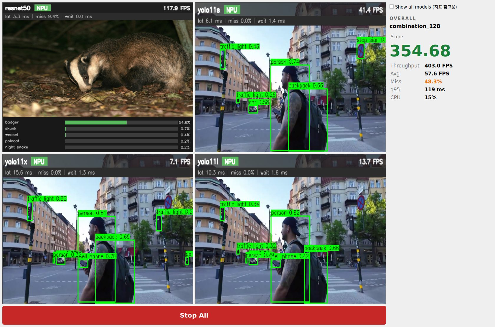
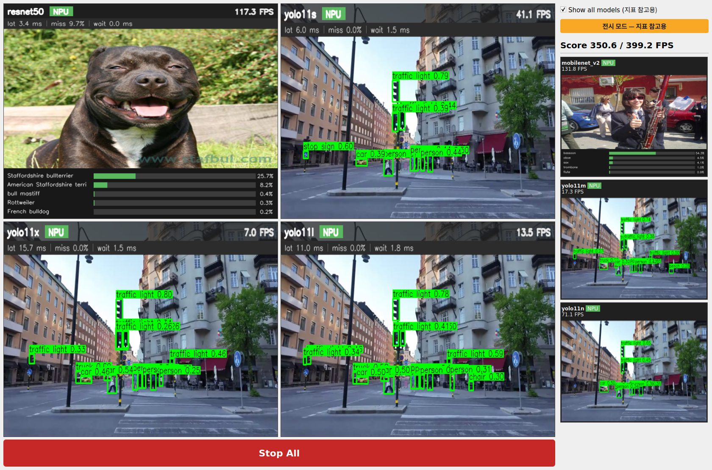

**8모델(S8) — 측정 → 전시 (조연 4개, 2열 auto-flow)**

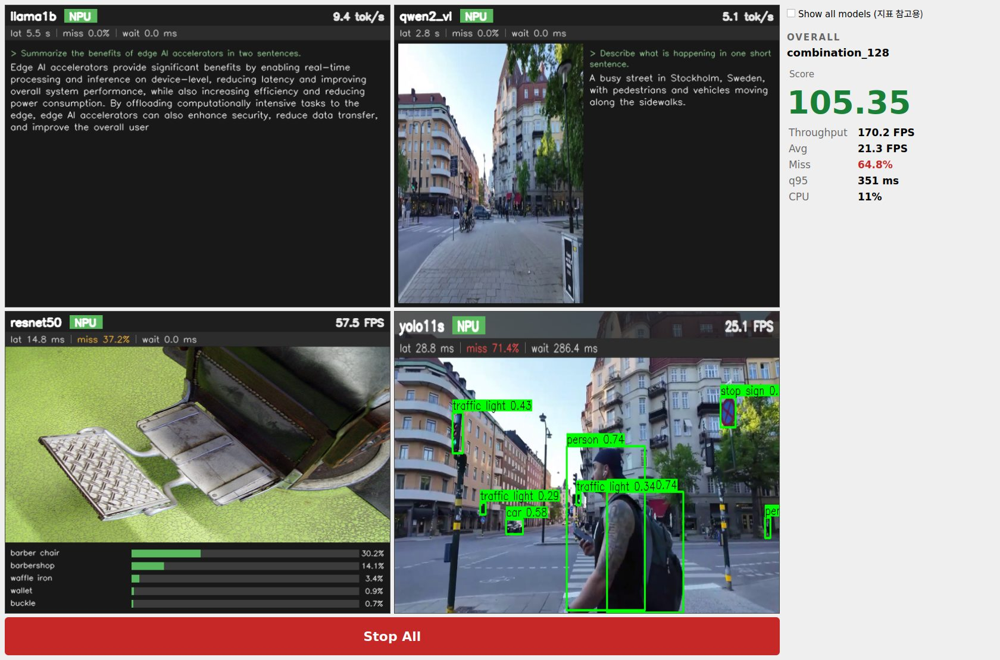
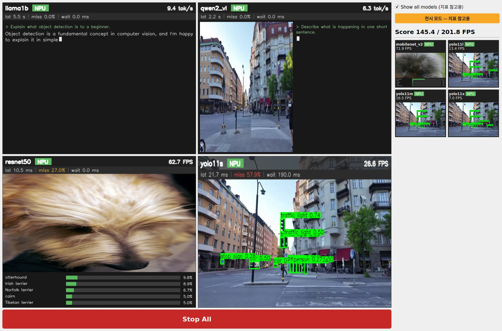

**8모델(S8) — 전시로 시작 후 측정으로 복귀한 직후**

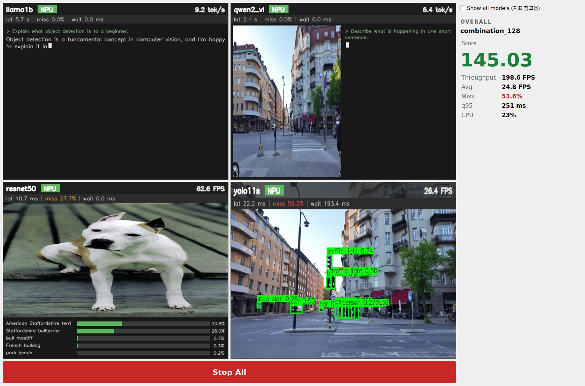

**4모델(base2) — 측정 모드 집계 패널 / 전시 전환 후(조연 0개 안내문)**

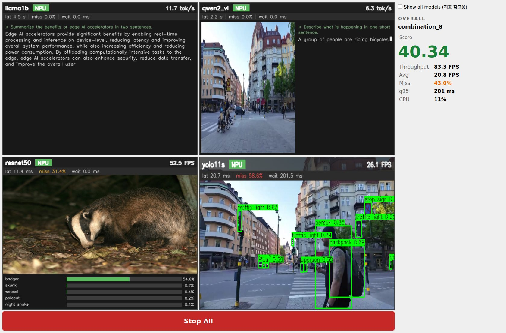
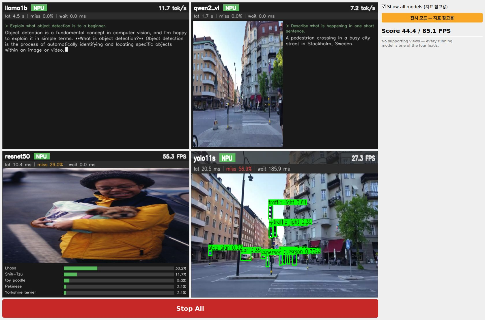

**2모델(S1) — 2 타일 + 2 X / 3모델(S3) — 3 타일 + 1 X, 전시 모드**

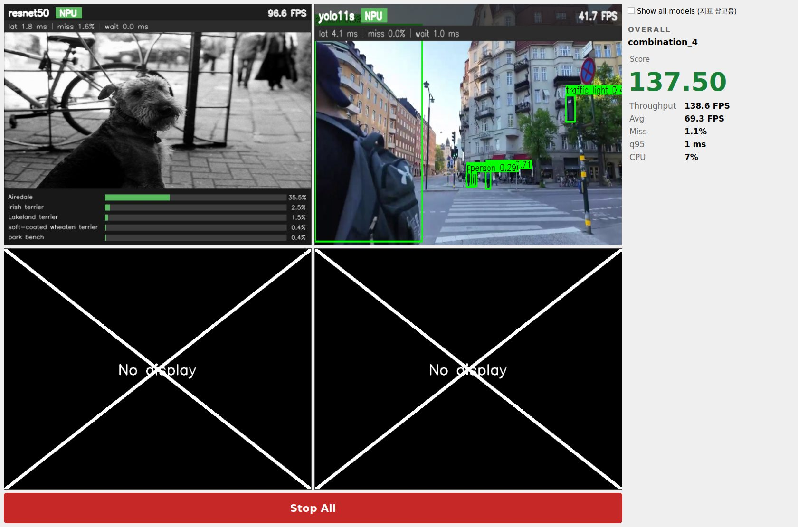
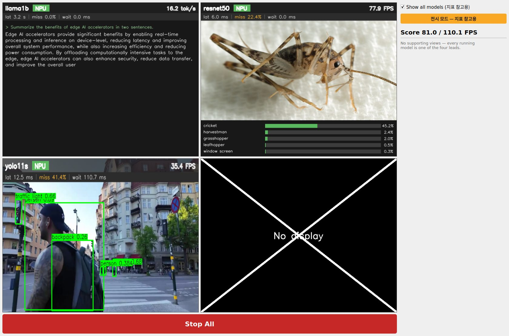

**메인 창 — `Show all models (지표 참고용)` 체크박스**

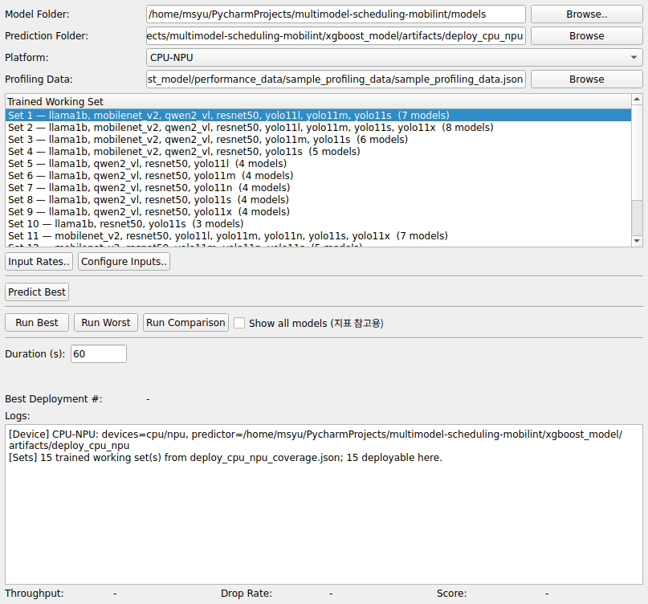

## 7. B.3-bis — 실행 중 working set 변경 (6회)

실행 중(창이 뜬 지 15초)에 메인 목록에서 다른 세트를 선택하고 Run Best를 눌렀다. 각 모드에서 먼저
S4(3모델)를 띄워 놓고 3번씩 바꿨다: 측정 S4→base2→S8→S1, 전시 S4→S8→base2→S10.

| 모드 | 변경 | 종료확인 (exit / 잔존 / NPU / 소요) | 겹침 (확인→새 워커 시작) | 모드 (시작/조연 표시) | 주연 재선정 | 초기화 | 창·2×2 유지 | 추론건수 |
|---|---|---|---|---|---|:--:|:--:|---|
| 측정 | S4 → base2 (4모델) | ✓ exit [0] / 0 / 0 MB / 1.4 s | ✓ +0.72 s | ✓ measure, 조연 0/0 | ✓ llama1b·qwen2_vl·resnet50·yolo11s | ✓ | ✓ | ✓ llama1b 1, qwen2_vl 2, resnet50 627, yolo11s 302 |
| 측정 | base2 → S8 (8모델) | ✓ exit [0] / 0 / 0 MB / 2.1 s | ✓ +8.15 s | ✓ measure, 조연 0/4 | ✓ llama1b·qwen2_vl·resnet50·yolo11s | ✓ | ✓ | ✓ llama1b 1, qwen2_vl 1, resnet50 476, yolo11s 221, mobilenet_v2 525, yolo11l 129, yolo11m 152, yolo11x 70 |
| 측정 | S8 → S1 (2모델) | ✓ exit [0] / 0 / 0 MB / 1.6 s | ✓ +0.4 s | ✓ measure, 조연 0/0 | ✓ resnet50·yolo11s +2X | ✓ | ✓ | ✓ resnet50 1018, yolo11s 440 |
| 전시 | S4 → S8 (8모델) | ✓ exit [0] / 0 / 0 MB / 1.5 s | ✓ +8.27 s | ✓ exhibition, 조연 4/4 | ✓ llama1b·qwen2_vl·resnet50·yolo11s | ✓ | ✓ | ✓ llama1b 1, qwen2_vl 2, resnet50 544, yolo11s 244, mobilenet_v2 591, yolo11l 138, yolo11m 165, yolo11x 73 |
| 전시 | S8 → base2 (4모델) | ✓ exit [0] / 0 / 0 MB / 1.7 s | ✓ +0.76 s | ✓ exhibition, 조연 0/0 | ✓ llama1b·qwen2_vl·resnet50·yolo11s | ✓ | ✓ | ✓ llama1b 1, qwen2_vl 2, resnet50 630, yolo11s 306 |
| 전시 | base2 → S10 (7모델) | ✓ exit [0] / 0 / 0 MB / 5.3 s | ✓ +6.42 s | ✓ exhibition, 조연 3/3 | ✓ resnet50·yolo11s·yolo11x·yolo11l | ✓ | ✓ | ✓ resnet50 1185, yolo11s 416, yolo11x 70, yolo11l 137, mobilenet_v2 1325, yolo11m 175, yolo11n 726 |

- **종료 확인**: executor exit code 0(강제 kill 0건), 종료 전에 기록해 둔 executor+워커 PID 중 생존 0,
  `mobilint-cli status` NPU 메모리 0MB. 요청 → 확인 완료까지 1.4~5.3초.
- **겹침 0**: "확인 완료" 시각이 새 세트의 첫 워커 시작 로그보다 항상 앞선다(+0.4~8.3초; 8초대는
  8모델·7모델 세트의 Predict 시간).
- **DRAM 복귀**: 종료 직전 10.7~13.2GB → 종료 확인 시 8.9~9.0GB (6회 모두 같은 수준으로 복귀. 9GB는
  테스트 프로세스와 데스크톱을 포함한 시스템 전체 사용량).
- **초기화**: 새 Display의 첫 상태 샘플에서 완료 건수 0, 지표 띠 비어 있음, Score `--`
  (직전 세트의 Score는 56.80~141.20이었다). 워커 PID도 이전 세트와 겹치지 않는다.
- **창·2×2 유지**: 6회 모두 창 `(45, 72) 1680×1110`, 좌측 `[8, 8, 1302, 1094]`, 주연 타일 648×509.
- 전시 모드로 바꾼 3회는 새 세트가 **처음부터** 조연까지 렌더링했다(S8 4/4, base2 0/0, S10 3/3).

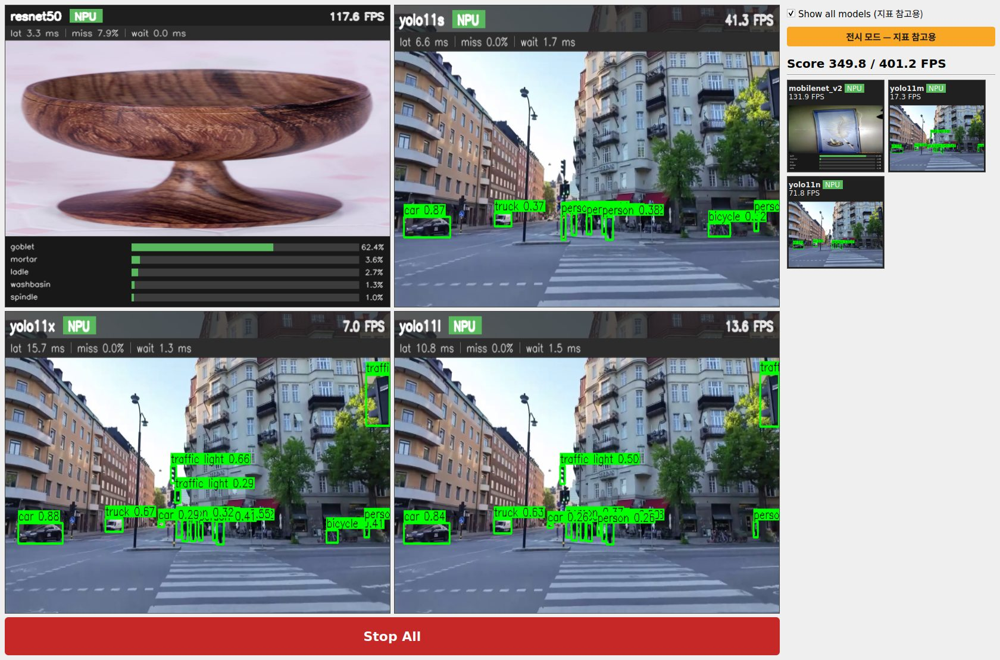
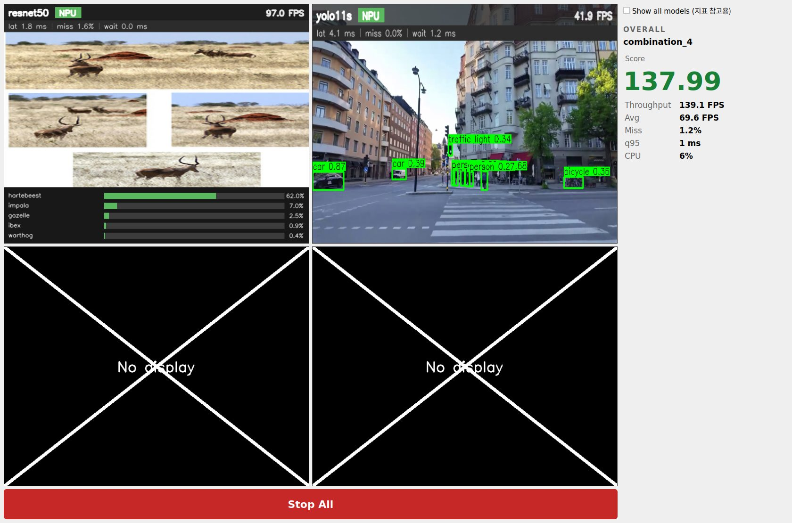

## 8. B.4 — 측정 정합성 스팟체크

전환 없이 측정 모드 60초 / 전시 모드 60초(warmup 20초 별도), 같은 best 조합. 지시문의 예시인
base2는 4모델이라 **조연이 0개** — 전시 모드에서도 추가로 그리는 것이 없다. 그래서 조연 4개가 실제로
그려지는 S8도 함께 돌렸다.

| 세트 (조합) | 모드 | `exhibition_ratio` | Throughput FPS | tokens/s | Miss | 완료 건수 (모델별) |
|---|---|---:|---:|---:|---:|---|
| base2 (combination_8) | 측정 | 0.0 | 97.58 | 21.79 | 0.5847 | llama1b 5, qwen2_vl 9, resnet50 3940, yolo11s 1900 |
| base2 (combination_8) | 전시 | 1.0 | 97.11 | 21.50 | 0.6041 | llama1b 5, qwen2_vl 9, resnet50 3916, yolo11s 1896 |
| S8 (combination_128) | 측정 | 0.0 | 202.93 | 17.26 | 0.5462 | llama1b 5, qwen2_vl 9, mobilenet_v2 4341, resnet50 3923, yolo11l 812, yolo11m 1005, yolo11s 1675, yolo11x 421 |
| S8 (combination_128) | 전시 | 1.0 | 200.03 | 17.20 | 0.5649 | llama1b 5, qwen2_vl 8, mobilenet_v2 4246, resnet50 3847, yolo11l 815, yolo11m 1000, yolo11s 1665, yolo11x 421 |

- **로드된 모델은 두 모드에서 동일** (base2 4개, S8 8개 — 같은 모델, 같은 디바이스).
- **완료 건수는 "동일"이 아니라 "거의 같음"이다.** 실제 하드웨어 실행이라 비트 단위로 같을 수는 없다.
  - base2(추가 렌더링 **없음**): Throughput −0.5%, Miss +1.9%p, 완료 건수 차이 0~0.6%
    (resnet50 −0.6%, yolo11s −0.2%). 그리는 것이 똑같은데도 이만큼 다르므로 **이것이 run 간 잡음**이다.
  - S8(조연 4개 렌더링): Throughput −1.4%, Miss +1.9%p, 비전 모델별 −2.2%~+0.4%
    (mobilenet_v2 −2.2%, resnet50 −1.9%), qwen2_vl 9→8건.
- **해석의 한계**: S8의 Miss +1.9%p는 base2의 잡음과 **같은 크기**라 전시 모드의 영향이라고 할 수 없다.
  Throughput −1.4%는 base2 잡음(−0.5%)의 3배쯤이고 방향도 "전시가 낮다"로 일관되지만, 조건당 1회뿐이라
  렌더링 부하 때문인지 가를 수 없다. 이 데이터가 뒷받침하는 것은 "전시 모드 수치는 측정 모드와 1~2%
  수준에서 어긋날 수 있고, 그 이상은 관찰되지 않았다"까지다. 정량화하려면 조건당 반복이 필요하다.
- 렌더링 외 로직이 같다는 점은 코드로도 확인된다: 모드는 `render_enabled`와 우측 페이지만 바꾸고,
  워커 프로세스·피더·통계 갱신 경로에는 모드 분기가 없다.

## 9. 실패 목록 + 원인

### 9.1 PART B 첫 실행: 27/30 — 3건 실패, 원인은 테스트 판정 기준

| 세트 | 시작모드 | 실패 항목 | 실제 상태 |
|---:|---|---|---|
| 8 | 측정 | `strip:llama1b` | llama1b 2건 완료, 띠 `lat 4.5 s \| miss 0.0% \| wait 0.0 ms` 정상 표시 |
| 9 | 전시 | `strip:llama1b` | llama1b 2건 완료, 띠 `lat 5.1 s …` 정상 표시 |
| 10 | 측정 | `strip:llama1b` | llama1b 3건 완료, 띠 `lat 3.2 s …` 정상 표시 |

**원인**: `test_all_sets_display.py`의 지표 띠 판정(현재 252~257행 부근)이 처음에는 "숫자가 들어간 띠
문자열이 **2종 이상**"을 모든 주연에 요구했다. 띠는 그 뷰가 무언가를 완료해야 바뀌는데 NPU llama1b는
30초에 2~3건만 완료하고, 생성 시간이 일정해서 평균이 같은 표시값(`3.2 s`)으로 반올림된다. 제품이
아니라 기준이 틀렸다.

**수정**: 완료 건수에 비례하도록 바꿨다 — 5건 이상 완료한 뷰는 서로 다른 값 2종 이상, 그 미만인
뷰는 `--` 자리표시에서 실제 숫자로 바뀌었을 것. 세트 8·9·10을 다시 돌려(6 run) 전부 통과 →
**30/30**. 세트 11~15의 첫 실행분은 원래의 더 엄격한 기준으로 통과했다. (같은 종류의 뷰가 다른
세트에서는 통과하고 이 3건만 떨어진 것은 완료 시점과 반올림에 따른 우연이다.)

### 9.2 검증 과정에서 찾아 고친 제품 결함 5건

| # | 증상 | 원인 (파일:줄) | 수정 |
|---|---|---|---|
| 1 | **Stop All을 누르면 창이 얼어붙고 끝나지 않음** (기존 4슬롯 보고서의 exit −9와 같은 뿌리로 보임) | `unified_viewer.py` `_cleanup_queues`의 drain. 3초 안에 못 끝나 terminate된 워커가 결과를 쓰다 만 메시지를 `get_nowait()`가 끝없이 기다린다. 부모가 그 파이프의 쓰기 끝을 계속 열고 있어 EOF가 오지 않는다. | 워커만 쓰는 큐(결과 큐, 비디오 프레임 큐)는 drain 전에 부모 쪽 쓰기 끝을 닫는다(`_close_writer`, 1384행). 정리 순서는 그대로. |
| 2 | Stop All로 멈춰 둔 화면이 Duration 뒤에 **저절로 새 실행으로 교체됨** | `schedule_executor_main.py` `_after_stop`: 시작 때 걸어 둔 사이클 타이머가 Stop All을 모른다. | Display의 `stopped` 이벤트에서 `_running = False` (`_on_viewer_event`, 196행). |
| 3 | 세트 변경 후 새 창이 폭 1040으로 줄고 위로 37px 이동 | 처음에 옵션 이름을 `--geometry`로 지었는데 Qt가 이 옵션을 자기 것으로 해석했다. | `--window_rect`로 변경(424행). 이후 B2 30 run과 세트 변경 6회 모두 위치·크기 동일. |
| 4 | **메인 창이 비정상 종료하면 executor도 워커를 남긴 채 죽음** (NPU 5.5GB 점유한 고아 프로세스) | executor의 stdout이 끊긴 파이프가 되어, 종료 경로의 첫 `print`가 `BrokenPipeError` → PyQt가 프로세스를 abort. | `_PipeSafeStream`(44행)으로 출력 실패를 삼키고, 제어 채널 EOF 시 `on_launcher_gone`(179행)이 정상 종료 경로를 탄다. 런처를 SIGKILL해서 확인: 5초 안에 프로세스 0, NPU 0MB. |
| 5 | 실행 중 Run 버튼을 다시 누르면 executor 2개가 동시에 뜸 | `best_deploy_finder_executor.py`: 실행 중 여부를 보지 않고 바로 launch. | §4b의 종료 → 확인 → 시작 흐름(`_request_run`, 1144행). |

1·2·4·5는 이번 개편 이전부터 있던 것이고, 3은 이번 작업 중에 만들었다가 잡은 것이다.

### 9.3 남은 한계 · 알아둘 점

- **육안 미확인**: 위 "검증 조건" 1번. 캡처는 Qt가 그린 창 내용이지 모니터 사진이 아니다.
- **Display 재사용 아님**: 세트 변경 시 창이 닫혔다가 같은 자리에 다시 뜬다(1.4~5.3초 + Predict 시간).
- **Predict Best를 실행 도중 수동으로 누르는 경우**: `model_schedules.yaml`을 덮어쓰는데, 실행 중인
  executor는 사이클이 바뀔 때 이 파일을 다시 읽는다. Predict 후 곧바로 Run을 누르면 문제없지만(먼저
  전부 종료함), Predict만 누르고 방치하면 다음 사이클에서 다른 세트의 조합이 뜰 수 있다. 기존 동작이며
  이번에 고치지 않았다. (다른 세트를 고르고 Run만 누르면 Predict는 자동으로, 종료 확인 뒤에 돈다.)
- **CPU llama1b 예외 경로는 실행되지 않았다**(15세트의 best가 모두 llama1b→NPU). 테스트에 분기는 있지만
  이번 실행으로 검증된 것은 아니다.
- B.4는 조건당 1회라 전시 모드의 영향 크기를 정량화하지 못했다(§8).
- 테스트 준비 중 `results/performance_*.json`(git-ignore된 실행 산출물)을 한 번 일괄 삭제했다.
  수집 스크립트도 매 실행마다 같은 패턴을 지우는 임시 파일이지만, 이전 데모 실행분이 남아 있었다면
  함께 지워졌다.

## 부록 — 변경 파일 · 재현

| 파일 | 변경 |
|---|---|
| `schedule_executor_display.ui` | 좌 2×2 + Stop All / 우 고정폭 열(토글·배지·2페이지 스택)로 재작성 |
| `info_window.ui` | 삭제 |
| `unified_viewer.py` | `InfoWindow` 삭제, `select_leads`, 조연 타일, `set_show_all`, 우측 패널 갱신, `display_mode` 기록, 큐 정리 hang 수정, 테스트 프로브 |
| `view_handlers.py` | 조연용 시그널/emitter, `render_enabled`(런타임 스위치), `render_now`, 지표 띠 삽입, 프레임 카운터 |
| `demo_render.py` | `insert_metric_strip`, `support_thumb`, miss 색 기준, `PARAMS_M` (크기순 기준값) |
| `schedule_executor_main.py` | `InfoWindow`/`Controller` 삭제, stdin 제어 채널, 이벤트 출력, 모드·창 위치 승계, 런처 소실 대응 |
| `best_deploy_finder_executor.ui` / `.py` | `show_all_checkbox`, 제어 채널 송수신, 종료→확인→재시작 흐름 |
| `test_all_sets_display.py` | 기존 15세트 순차 테스트를 PART B(B2 / BIS / B4)로 확장 |

```bash
./test_all_sets_display.sh                         # 전체 (약 35분)
PHASES=B2 ONLY_SETS=2,11 ./test_all_sets_display.sh   # 일부 세트만
PHASES=BIS ./test_all_sets_display.sh              # working set 변경만
```
결과는 `$DISPLAY_TEST_OUT/results.json`(기본 `/tmp/display_test`), 캡처는 그 아래 `shots/`.
